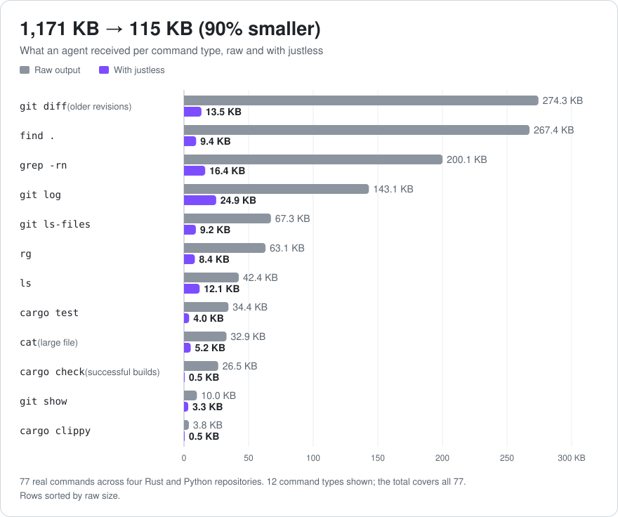
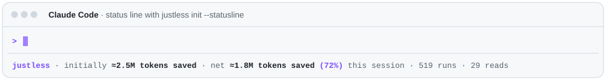
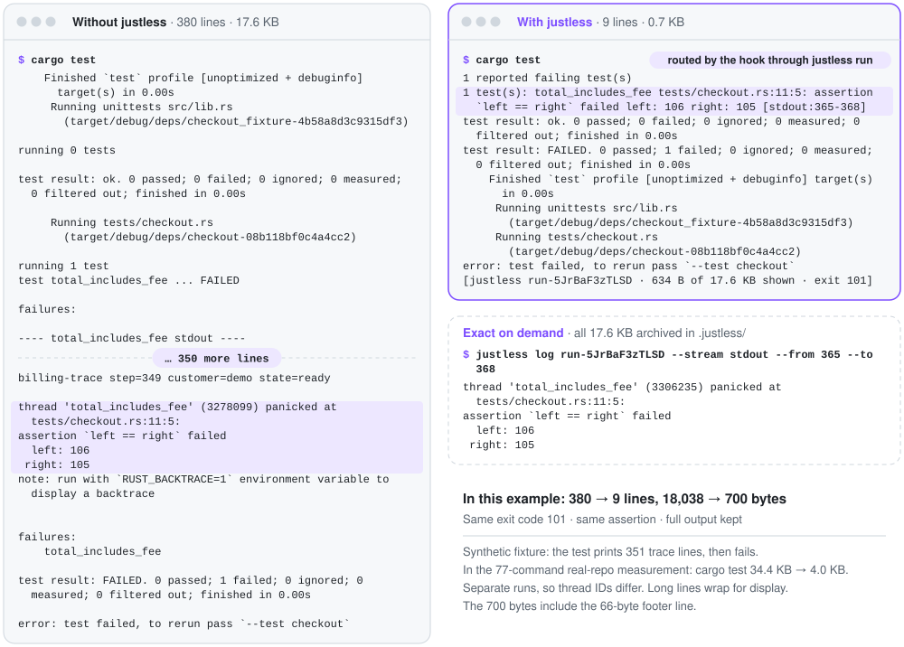

<p align="center">
  
</p>

<h1 align="center">justless</h1>

<p align="center">
  <strong>Your coding agent on 8× fewer tokens.</strong><br>
  One local tool instead of RTK + graphify + context pruning. Compact by default, exact on demand.
</p>

<p align="center">
  <a href="#install">Install</a> · <a href="docs/reference.md">Reference</a> · <a href="docs/examples.md">Examples</a> · <a href="docs/benchmarks.md">Benchmarks</a> · <a href="CHANGELOG.md">Changelog</a>
</p>

<p align="center">
  <strong>8×</strong> fewer input tokens on a repair task · <strong>10×</strong> less command output · <strong>57×</strong> smaller answers to code questions · <strong>85×</strong> smaller reads of old revisions · <strong>0</strong> network calls
</p>

**justless** is a local Rust CLI that sits between your coding agent and its tools. It intercepts shell commands through agent hooks and parses their output into compact, structured results. It answers code questions from an incremental **code graph** of symbols, calls, imports, HTTP routes and SQL tables, so agents stop reading whole files. Every byte it cuts is archived locally and one command away.

> **🔒 100% local. Zero network calls.** justless runs entirely on your machine, between your agent and your shell. It sends nothing anywhere: no telemetry, no analytics, no cloud service, no LLM, no account. Your code and command output never leave your computer. The one exception is opt-in: `justless wrap claude` relays Claude Code's own API requests to Anthropic and adds no requests of its own.

## How much it saves

| What your agent does | Without justless | With justless | Cut |
| --- | ---: | ---: | ---: |
| A three-turn repair task, input tokens as the API counted them, on Claude Haiku, Sonnet, Opus 5.5 and Fable 5.2 | 22.4–22.8k | ~2.85k | **8×** |
| 77 real commands across four Rust and Python repositories | 1,171 KB | 115 KB | **10×** |
| "Where is `X` and what calls it?": search and read the file, or `justless query X` (14 functions, median) | 1.14 MB | 19 KB | **57×** |
| One function from a 21 KB source file: read the file, or its outline and then that function (`expand`) | 21 KB | 2.1 KB + 60 B | **10×** |
| A file at an old revision, `git show HEAD:CHANGELOG.md` | 29.2 KB | 345 B | **85×** |
| `find .` | 267 KB | 9.4 KB | **28×** |
| `cargo test` with one failing test ([`fixtures/failing`](fixtures/failing)) | 18,038 B | 700 B | **26×** |
| `cargo clippy -- -W clippy::pedantic` on this repository, 142 warnings | 79,563 B | 3,916 B | **20×** |
| `git diff` against older revisions | 274 KB | 13.5 KB | **20×** |
| Claude Code `Read` calls of more than 150 lines (167 windows) | 2.80 MB | 305 KB | **9×** |

<picture>
  <source media="(prefers-color-scheme: dark)" srcset="assets/savings-dark.svg">
  
</picture>

Originals stay recoverable and exit codes matched in every run. The repair task passed in all 24 runs; it is one task, and a broader benchmark is in progress. The code-question ratio grows with file size, and this repository's files are large. [Methods](docs/benchmarks.md)

### Watch it in your own sessions

<picture>
  <source media="(prefers-color-scheme: dark)" srcset="assets/statusline-dark.svg">
  
</picture>

```sh
justless init --statusline   # running total in Claude Code's status line
justless stats               # savings by day and command in this project
justless stats --all         # one total across every project on this machine
```

The line above is from a real Claude Code session. "Net" subtracts everything the agent later pulled back from the archive. Token figures are estimates from bytes per token measured against Claude's tokenizer; the byte counts are exact.

## One tool instead of three

Token-saving tools each take one slice of the context window. RTK compresses command output, graphify answers code questions from a graph, and context pruning clears old tool results. justless does all three in one local binary, and adds file reads, edits and test selection:

| | justless | RTK | graphify |
| --- | :---: | :---: | :---: |
| Compresses command output through agent hooks | ✅ | ✅ | — |
| Code graph: symbols, calls, imports, `query` and `path` | ✅ | — | ✅ |
| Outlines big files and returns one symbol's exact bytes | ✅ | — | — |
| Exact recall of anything it cut | ✅ | ✅ | — |
| Retires old tool results from the context | ✅ | — | — |
| Runs only the tests a change reaches | ✅ | — | — |
| Edits that check the file has not changed | ✅ | — | — |
| Secret redaction | ✅ | Paid edition | — |
| Token figures measured against Claude's tokenizer | ✅ | Bytes ÷ 4 | — |
| No network calls | ✅ | Partly | Partly |

<sub>RTK and graphify columns from each project's README on 2026-11-19; "—" means the README does not mention it. "Partly": RTK pipelines and its proxy can send content to models, and graphify's pass over docs and media can call a model backend. RTK supports more commands (100+) and agents (18); graphify more languages (about 40) and also reads docs, PDFs and images. [Full comparison](docs/comparison.md)</sub>

## How it cuts tokens

- **⚡ Compact Output.** `justless run` parses each tool's output: test failures grouped by diagnostic (cargo, pytest, Go, Jest/Vitest), lint findings grouped by rule ID with `file:line` (rustc, Clippy, Ruff, mypy, ESLint, tsc and more), searches grouped by file, listings by directory. Anything else becomes a 4 KB head, tail and error-line preview.
- **🎯 Exact Recall.** Every stream is archived byte for byte, up to 256 MiB, in `.justless/runs/<id>` with a SHA-256 digest. `justless log ID --from N --to M` replays exact lines, with secrets masked unless you add `--unredacted`; an identical rerun collapses to one line.
- **🔬 Surgical Reads.** syn and Tree-sitter outlines across 26 languages with revision-bound row IDs. `expand` returns one symbol's exact bytes; `edit` writes only the replacement after checking the revision.
- **🗺️ Code Map and Impact.** An incremental graph of symbols, calls, imports, HTTP routes and SQL relations. `pack` answers a question in one call, `lookup` ranks the few places that answer "where is X configured?", and `affected` walks back to the tests that reach a change.
- **🧪 Affected Tests.** `justless test --affected` runs only the tests that reach your Git changes, labels the result as a subset, and runs the full suite instead when the selection can't be trusted.
- **🔐 Secret Redaction.** Cloud keys, tokens and private keys in command output are masked everywhere the agent sees output: previews, footers, `log`, `search` and MCP results. The archive keeps the exact bytes for `log --unredacted`.
- **🧰 Scripts and Lessons.** `justless exec` runs a script the agent writes over large data, with whole head and tail lines and `--intent` ranking the lines that matter. `justless learn` proposes project rules from command mistakes agents keep repeating, and `--apply` adds them to the instructions.
- **🧹 Context Hygiene.** A footer only when output was cut, failed or had a secret masked, compaction hooks that carry run IDs and inspected ranges into the next turn, and an opt-in `justless wrap claude` that has the API clear old tool results server-side, with every original archived.


<picture>
  <source media="(prefers-color-scheme: dark)" srcset="assets/demo-dark.svg">
  
</picture>

<sub>The same run step by step: the compact result names the archived lines, and <code>justless log</code> returns them byte for byte. One long line is wrapped for display.</sub>

### One failing test

<picture>
  <source media="(prefers-color-scheme: dark)" srcset="assets/before-after-dark.svg">
  
</picture>

<sub>The deliberately failing test in <code>fixtures/failing</code>. The agent types <code>cargo test</code> in both windows; on the right, the hook routes it through <code>justless run</code>. Long lines are wrapped for display.</sub>

The exit status is still 101, and `justless log RUN_ID --stream stdout --from 365 --to 368` returns the archived lines byte for byte. [Full walkthrough](docs/examples.md#diagnose-and-fix-a-failing-test)

### What it does not do

- **No changed commands.** Same command, directory and exit code. Pipes, redirections other than a final `2>&1`, interactive and machine-readable output pass through.
- **No network, no LLM, no telemetry.** Parsing is local and deterministic; everything stays in `.justless/`. Only the installer goes online, plus the opt-in `wrap` proxy, which relays your agent's own API requests.
- **No hidden failures.** Anything cut is marked and one command away.

## Install

Run your agent's line **inside your project folder**. It installs justless and turns it on for that project, using a prebuilt binary when a release exists and otherwise building with [Rust](https://rustup.rs).

```sh
# Claude Code: then start a new session
curl -fsSL https://raw.githubusercontent.com/rishadbaniya/justless/main/install.sh | sh -s -- claude
# Codex: then run /hooks once and trust them
curl -fsSL https://raw.githubusercontent.com/rishadbaniya/justless/main/install.sh | sh -s -- codex
# Cursor, Gemini CLI, Copilot CLI, OpenCode, Antigravity CLI: then start a new session
curl -fsSL https://raw.githubusercontent.com/rishadbaniya/justless/main/install.sh | sh -s -- cursor     # or gemini, copilot, opencode, agy
# Several agents at once, or every agent on your PATH
curl -fsSL https://raw.githubusercontent.com/rishadbaniya/justless/main/install.sh | sh -s -- claude codex
curl -fsSL https://raw.githubusercontent.com/rishadbaniya/justless/main/install.sh | sh
```

Clients without hooks, such as VS Code, can use the read-only tools over MCP: `justless mcp --install vscode`. For another project later, run `justless init --hooks --agent claude` there.

To cover every project at once instead, `justless init --global` adds opt-in user-level hooks for Claude Code and Codex ([details](docs/reference.md#global-hooks)).

**Check it works:** `justless doctor` checks the setup and prints a fix for anything missing, `justless run -- git status` ends with a `[justless run-…]` line, and `justless stats` shows what was saved. In Claude Code, `justless init --statusline` keeps a running total in the status line. To update, see [install options](docs/reference.md#install-and-configure-agents). `justless init --remove` takes it back out of a project.

## How it works

<picture>
  <source media="(prefers-color-scheme: dark)" srcset="assets/how-it-works-dark.svg">
  
</picture>

Hooks route commands through `justless run`, a local index answers code questions, older tool results retire to an ID, and `log`, `expand` and `recall` return the original bytes whenever a summary is not enough.

[Command reference](docs/reference.md) · [Worked examples](docs/examples.md) · [Benchmarks](docs/benchmarks.md) · [How it compares](docs/comparison.md) · [FAQ](docs/faq.md)

## Contributing

Build, test and commit conventions are in [CONTRIBUTING.md](CONTRIBUTING.md), maintainer notes in [AGENTS.md](AGENTS.md), and changes in the [changelog](CHANGELOG.md).
