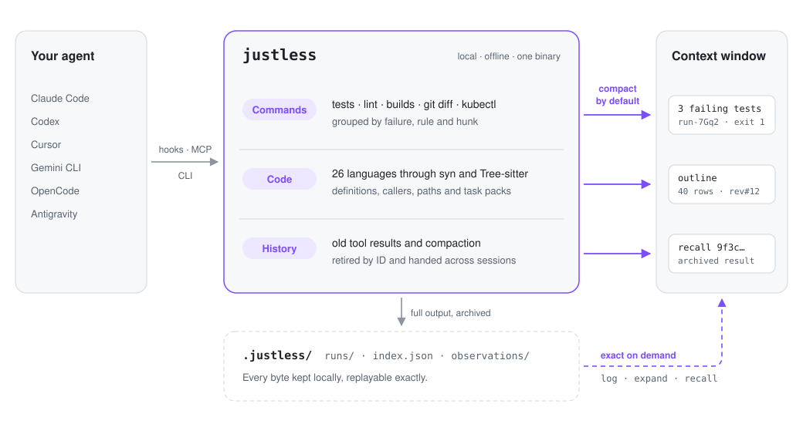

<p align="center">
  
</p>

<h1 align="center">justless</h1>

<p align="center">
  <strong>Your agent reads less. It knows more.</strong><br>
  Compact by default. Exact on demand.
</p>

<p align="center">
  <a href="#install">Install</a> · <a href="docs/reference.md">Reference</a> · <a href="docs/examples.md">Examples</a> · <a href="docs/benchmarks.md">Benchmarks</a>
</p>

Justless is a local CLI that cuts the tokens coding agents spend on command output, source reads and old tool results. It sits between the agent and your shell through hooks, so agents keep running their usual commands.

## How it cuts tokens

- **⚡ Compact Output.** Test failures grouped by cause, lint by rule, matches by file. Errors always kept.
- **🎯 Exact Recall.** Every run archived. Replay any line instead of rerunning.
- **🔬 Surgical Reads.** Outline first, then only the symbol you need.
- **🗺️ Code Map and Impact.** Find code, callers and the tests to run without reading files.
- **🧹 Context Hygiene.** Identical reruns collapse to one line; your place survives compaction.

### Measured

| What the agent ran | Raw output | With Justless |
| --- | ---: | ---: |
| 77 real commands across four Rust and Python repositories | 1,171 KB | **115 KB** (90% smaller) |
| `git diff` against older revisions | 274 KB | 13.5 KB |
| `find .` | 267 KB | 9.4 KB |
| `grep -rn` | 200 KB | 16.4 KB |
| `cargo check`, successful builds in three repositories | 26.5 KB | 0.5 KB |
| One 21 KB source file: outline, then one symbol | 21 KB | 2.1 KB, then 60 B |
| Three-turn repair task, provider-reported input tokens (Claude Haiku 5.5) | 22,364 | **2,851** (87% fewer) |

Originals stay recoverable and exit codes matched in every run. The repair task is one task run twice; a broader benchmark is in progress. [Methods](docs/benchmarks.md)

### What it does not do

- **No changed commands.** Same command, same exit code. Pipes and machine formats pass through.
- **No LLM, no network.** Deterministic local parsing; everything stays in `.justless/`.
- **No hidden failures.** Anything cut is marked and one command away.

## Install

Run the line for your agent **inside your project folder**. It installs Justless and turns it on for that project. It downloads a prebuilt binary when a release exists for your platform and otherwise builds from source, which needs [Rust](https://rustup.rs).

### Claude Code

```sh
curl -fsSL https://raw.githubusercontent.com/rishadbaniya/justless/main/install.sh | sh -s -- claude
```

Then start a new `claude` session.

### Codex

```sh
curl -fsSL https://raw.githubusercontent.com/rishadbaniya/justless/main/install.sh | sh -s -- codex
```

Then run `/hooks` in Codex once and trust the hooks.

### Cursor

```sh
curl -fsSL https://raw.githubusercontent.com/rishadbaniya/justless/main/install.sh | sh -s -- cursor
```

Then start a new agent chat.

### Gemini CLI

```sh
curl -fsSL https://raw.githubusercontent.com/rishadbaniya/justless/main/install.sh | sh -s -- gemini
```

Then start a new session.

### GitHub Copilot CLI

```sh
curl -fsSL https://raw.githubusercontent.com/rishadbaniya/justless/main/install.sh | sh -s -- copilot
```

Then start a new session.

### OpenCode

```sh
curl -fsSL https://raw.githubusercontent.com/rishadbaniya/justless/main/install.sh | sh -s -- opencode
```

Then restart OpenCode.

### Antigravity CLI

```sh
curl -fsSL https://raw.githubusercontent.com/rishadbaniya/justless/main/install.sh | sh -s -- agy
```

Then start a new session.

### Several agents, or every agent on your machine

```sh
curl -fsSL https://raw.githubusercontent.com/rishadbaniya/justless/main/install.sh | sh -s -- claude codex   # name the agents you use
curl -fsSL https://raw.githubusercontent.com/rishadbaniya/justless/main/install.sh | sh                      # set up every agent found on your PATH
```

### Other MCP clients, such as VS Code

```sh
justless mcp --install vscode   # also: claude, cursor, gemini, codex
```

This gives the client Justless's read-only navigation tools without hooks.

### Check that it works

```sh
justless run -- git status   # ends with a line like: [justless run-…] exit 0 · …
```

In an agent session, run your tests. Compact or failing output ends with a `[justless run-…]` marker. `justless stats` shows what was saved, and `justless discover` lists commands that still bypassed Justless.

### Add another project later

The binary only needs installing once. In any other project, run `justless init --hooks --agent claude` (or `codex`, `cursor`, `gemini`, `copilot`, `opencode`, `agy`). Setup keeps your existing instructions and settings, and running it again is safe.

### Update or remove

To update, run your install line again, then rerun `justless init --hooks --agent …` in your projects to pick up new hooks. To remove Justless from a project, delete the section between `<!-- justless:begin -->` and `<!-- justless:end -->` in `CLAUDE.md`, `AGENTS.md` or `GEMINI.md`, the `justless` hook entries in the agent's config file, and the `.justless/` directory. [All install options](docs/reference.md#install-and-configure-agents)

## Features

- **Progressive reads.** Browse signatures and line ranges, then expand one symbol or Markdown section to its exact source.
- **Verified edits.** Send just the replacement for a symbol or line range. Preview a diff or apply a same-file batch atomically. Stale revisions are rejected.
- **Recoverable tool history.** Keep recent results in context and retire older ones to local storage with OpenCode v1 or an API integration. Recover any archived result by ID.
- **Task packs.** Give `justless pack` a question and a budget. It gathers relevant source lines, callers, tests, and recent failures in one response.
- **Cross-language navigation.** Trace a TypeScript request through a Python handler to a SQL table. Each link points to a source line, and inferred links are marked as possible.
- **Repository map and change impact.** `justless map` shows a new repository's areas, hubs, linked communities, cross-language links, entry points and tests in one budgeted report. `justless affected` lists what depends on a symbol, file or your current changes, hop by hop, and the tests to run.
- **Search across code, docs, and config.** Find a literal in a runbook or an unfamiliar file type. The index refreshes after edits and reuses unchanged files.
- **Grouped test failures.** See which tests reported the same error, then jump from the captured diagnostic to the assertion or function that produced it.
- **Grouped lint findings.** Compiler and linter output from Clippy, Ruff, mypy, ESLint, tsc, ShellCheck, golangci-lint and others collapses to one line per rule with counts and locations. Errors keep their full detail.
- **Rerun comparisons.** Run the same command after an edit to see which failures or diff hunks appeared or disappeared. Identical output can collapse to a single line.
- **Exact log replay.** Every captured run has an ID. Search its full output or replay a specific range of stdout or stderr, byte for byte.
- **Context that survives compaction.** Claude Code and Codex hooks carry recent run IDs, outcomes and inspected files across compaction, so agents recover logs instead of rerunning commands.
- **Cross-session handoffs.** Search earlier runs for an error, or use `justless resume` to see what the last session inspected and which files have changed since.
- **MCP server.** Cursor, Gemini CLI, VS Code and other MCP clients can call the read-only navigation commands as tools with `justless mcp`. `justless mcp --install cursor` adds it to the project's client config.
- **Savings you can see.** `justless stats` shows bytes and estimated tokens saved by day and by command, and how often agents reopened full logs. `justless discover` finds commands agents ran without Justless in Claude Code transcripts.

On one three-turn repair task, Claude used **87.3% fewer input tokens** with Justless. Both runs produced a fix that passed independent tests. [Benchmark and tool-call counts](docs/benchmarks.md#three-turn-repair)

## Use from the terminal

```sh
justless read src/main.rs --outline  # Expand a row with justless expand FILE 'REV#ID'
justless pack "What breaks if I rename purchase_orders?"
justless run -- git diff      # Run again after an edit to see changed hunks
justless resume              # Pick up where the last session left off
```

## How it works

<picture>
  <source media="(prefers-color-scheme: dark)" srcset="assets/how-it-works-dark.svg">
  
</picture>

- **Commands.** Hooks route builds, tests, linters, diffs, searches, file listings and cluster listings through `justless run`. The agent sees grouped failures, rules, hunks, matches by file and paths by directory with a run ID instead of the raw stream. Claude Code's Grep and Glob results are grouped the same way.
- **Code.** A local index of 21 languages answers definition, caller, path and task-pack questions, so the agent reads the lines it needs rather than whole files.
- **History.** Older tool results are retired to an ID, and recent activity is carried across compaction and sessions.
- **Exact on demand.** Everything is archived in `.justless/`. `log`, `expand` and `recall` return the original bytes whenever the summary is not enough.

[Command reference](docs/reference.md) · [Worked examples](docs/examples.md) · [Benchmarks](docs/benchmarks.md)
